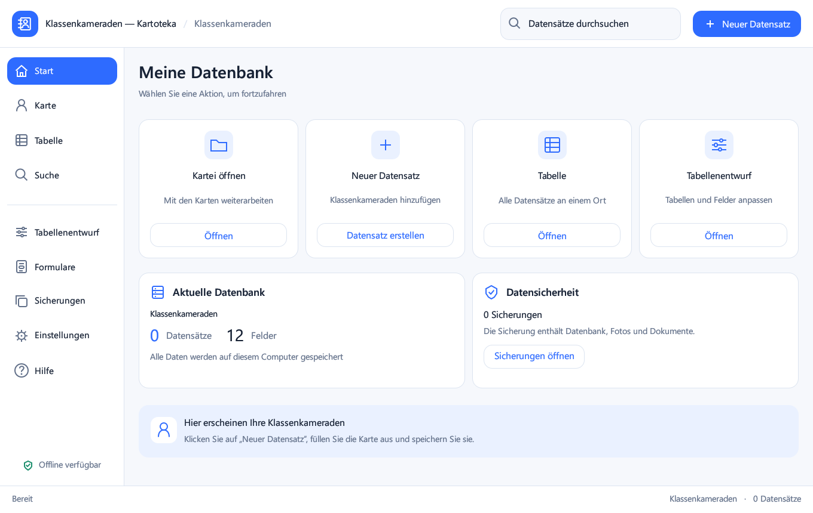

# Klassenkameraden — Kartoteka

[RU](README.ru.md) · [DE](README.de.md) · [EN](README.md)

**Ihre lokale Kartei für Windows · 0.5.0 · Windows 11 x64**

Verwalten Sie Klassenkameraden und andere Listen auf Ihrem eigenen Computer. Karten, Tabellen, eigene Felder, Fotos, Dokumente, Suche und Sicherungen in einer Anwendung.

[Für Windows herunterladen](https://github.com/popovantondev/Kartoteka/releases/download/v0.5.0/Kartoteka-0.5.0-Setup.exe) · [Portable ZIP](https://github.com/popovantondev/Kartoteka/releases/download/v0.5.0/Kartoteka-0.5.0-Windows-x64.zip) · [Anleitung](https://popovantondev.github.io/Kartoteka/Guide-de.html) · [Alle Programme](https://popovantondev.github.io/popovantondev/index-de.html)

Echte Oberfläche 0.5.0. Demonstrationsdatenbank ohne persönliche Daten.

## Funktionen

- Datensatzkarten und Gesamttabelle mit anpassbaren Spaltenbreiten.
- Eigene Tabellen und 11 Feldtypen: Text, Zahlen, Datum, Uhrzeit, Datum/Uhrzeit, Kontrollkästchen, URL, Foto und Dokument.
- Fotovorschau, verwaltete lokale Dokumentkopien und Website-Links.
- Suche in der ausgewählten Tabelle, Filter für geladene Zeilen und CSV-Export.
- Sicherung von Datenbank und Anhängen; Schutzkopie vor einer Wiederherstellung.
- Helle Oberfläche, 80–150% Skalierung, einklappbares Menü und RU/DE/EN.

## Installation und Start

Starten Sie Kartoteka-0.5.0-Setup.exe und behalten Sie den vorgeschlagenen Benutzerordner. Administratorrechte und Rust sind nicht erforderlich. Speichern und schließen Sie die alte Anwendung vor einem Update. Ohne Installation: das gesamte portable ZIP entpacken; EXE und drei DLL-Dateien müssen zusammenbleiben.

## Sprache wählen

Öffnen Sie Einstellungen → Allgemein oder Darstellung → Sprache. Wählen Sie Русский, Deutsch oder English. Die Auswahl bleibt nach dem Neustart erhalten. Gespeicherte Namen und Werte werden nicht umgeschrieben; Standardbeschriftungen erscheinen in der gewählten Sprache. Systemische Dateidialoge verwenden die Windows-Sprache.

## Erster Datensatz

Wählen Sie „Neuer Datensatz“, füllen Sie die Pflichtfelder Nachname und Vorname aus, fügen Sie Foto oder Dokument hinzu und speichern Sie. Die unteren Schaltflächen wechseln zwischen Karten. Ein Doppelklick in der Tabelle öffnet die Karte. Vor dem Verlassen einer geänderten Karte wird nach dem Speichern gefragt.

## Tabellen und Felder

Erstellen Sie im Tabellenentwurf eine Tabelle und fügen Sie Felder mit Name, Typ, Pflichtstatus und Standardwert hinzu. Pfeile ändern die Reihenfolge; Ziehen der Kopfzeilengrenzen ändert Spaltenbreiten. Unter Formulare werden Sichtbarkeit und Vorschau eingestellt. Das Löschen eines Feldes erfordert Bestätigung und Schutzkopie.

## Fotos und Dokumente

Die ausgewählte Datei wird in den verwalteten Anhangordner kopiert. Speichern Sie den Datensatz, um sie zuzuordnen. Fotos: JPG/JPEG, PNG, BMP, WEBP, höchstens 25 MB und 40 Megapixel. Andere Dokumente: höchstens 250 MB. Dokumente öffnen sich in der Systemanwendung; HTTP/HTTPS-Links im Browser.

## Suche und CSV

Die Suche prüft alle Felder der ausgewählten Tabelle. Der Tabellenfilter gilt nur für geladene Zeilen. CSV exportiert die ausgewählte Tabelle; Text wird gegen Tabellenkalkulationsformeln abgesichert. Datumswerte bleiben YYYY-MM-DD, Uhrzeiten HH:MM.

## Datensicherung und Umzug

Datenordner: %LOCALAPPDATA%\Popovantondev\Kartoteka. Er enthält program_data.db, assets, backups und preferences.json. Daten sind unverschlüsselt. Zum Umzug zuerst sichern und bei geschlossener Anwendung den gesamten Datenordner auf den anderen Computer kopieren. Wiederherstellung verwendet Sicherungen aus der Programmliste und erstellt vorher eine Schutzkopie. Die Deinstallation erhält Ihre Daten.

## Tastenkürzel

Ctrl+S speichert; Ctrl+N erstellt einen Datensatz; Ctrl+F öffnet die Suche. Der Menütrenner unterstützt Ziehen und Doppelklick. Bei schmalen Fenstern klappt das Menü automatisch ein.

## Voraussetzungen und Grenzen

Auf Windows 11 x 64 geprüft. Die EXE ist nicht signiert. Die Tabelle zeigt bis zu 2000 Zeilen, die Suche bis zu 500 Treffer. Freie Formularanordnung und Microsoft-Access-Import sind nicht implementiert. Windows-DPI 125/150% und zwei Monitore sind nicht separat geprüft; die Schriftglättung hängt vom egui-Renderer ab. Keine Telemetrie; Kernfunktionen arbeiten offline.

## Aus Quellcode bauen

Erforderlich: Rust stable-x 86_64-pc-windows-gnullvm, rustfmt und LLVM-MinGW. scripts/build-noadmin.ps 1 sucht LLVM-MinGW unter %LOCALAPPDATA%\Popovantondev\KartotekaTools, führt fmt/check/test/release aus und erstellt dist mit EXE und DLLs. Setup: scripts/build-setup.ps 1 -NsisPath <Pfad zu makensis.exe>, NSIS 3.11. Cargo.lock fixiert Abhängigkeiten. Deren Lizenzen bleiben unverändert; für den Projektcode wurde noch keine eigene Lizenz festgelegt.

## Änderungen in 0.5.0

RU/DE/EN mit gespeicherter Sprachwahl; übersetzte Ansichten, Hilfe, Dialoge und Validierungsmeldungen. Lokalisierter Kalender und dreisprachiges Setup. Datenbankschema und Anhangformat bleiben mit 0.4.2 kompatibel.

## Prüfungen

Build-, Sprach-, Datenerhaltungs- und Setup-Prüfungen stehen in RELEASE-CHECKS.md. Prüfsummen der Release-Dateien: SHA 256 SUMS.txt. Dokumentationsprüfungen ersetzen keinen Test auf Ihrer Hardware.

[Fehler melden](https://github.com/popovantondev/Kartoteka/issues/new) · [Quellcode](https://github.com/popovantondev/Kartoteka)
