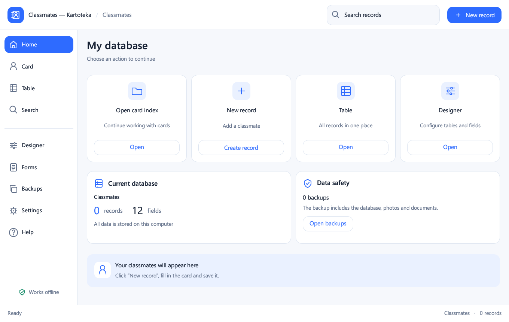

# Classmates — Kartoteka

[RU](README.ru.md) · [DE](README.de.md) · [EN](README.md)

**Your local card index for Windows · 0.5.0 · Windows 11 x64**

Keep classmates and other lists on your own computer. Cards, tables, custom fields, photos, documents, search and backups in one application.

[Download for Windows](https://github.com/popovantondev/Kartoteka/releases/download/v0.5.0/Kartoteka-0.5.0-Setup.exe) · [Portable ZIP](https://github.com/popovantondev/Kartoteka/releases/download/v0.5.0/Kartoteka-0.5.0-Windows-x64.zip) · [User guide](https://popovantondev.github.io/Kartoteka/Guide-en.html) · [All applications](https://popovantondev.github.io/popovantondev/index.html)

Actual 0.5.0 interface. Demonstration database without personal data.

## Features

- Record cards and a table with resizable columns.
- Custom tables and 11 field types: text, numbers, date, time, date/time, checkbox, URL, photo and document.
- Photo previews, managed local document copies and website links.
- Search across the selected table, loaded-row filtering and CSV export.
- Back up the database and attachments; a safety copy is made before restoring.
- Light theme, 80–150% scaling, collapsible menu and RU/DE/EN interface.

## Install and start

Run Kartoteka-0.5.0-Setup.exe and keep the suggested user folder. Administrator rights and Rust are not required. Save your work and close the old application before updating. For a portable launch, extract the entire ZIP; keep the EXE and three DLL files together.

## Choose a language

Open Settings → General or Appearance → Interface language and choose Русский, Deutsch or English. The choice survives restarts. Stored names and values are not rewritten; standard labels appear in the selected language. System file dialogs use the Windows language.

## Your first record

Click “New record”, fill in the required last and first names, attach a photo or document and click “Save”. The bottom buttons navigate between cards. Double-click a table row to open its card. Leaving an edited card prompts you to save it.

## Tables and fields

Create a table in Designer and add fields with a name, type, required flag and default value. Use arrows to reorder fields and drag header boundaries to resize columns. Forms controls visibility and shows a preview. Deleting a field requires confirmation and a safety copy.

## Photos and documents

The selected file is copied to the managed attachments folder. Save the record to attach it. Photos: JPG/JPEG, PNG, BMP, WEBP, up to 25 MB and 40 megapixels. Other documents: up to 250 MB. Documents open in the system application; HTTP/HTTPS links open in your browser.

## Search and CSV

Search checks every field in the selected table. The table filter only checks loaded rows. CSV exports the selected table and escapes text against spreadsheet formulas. Dates remain YYYY-MM-DD and times HH:MM.

## Data safety and moving computers

Data folder: %LOCALAPPDATA%\Popovantondev\Kartoteka. It contains program_data.db, assets, backups and preferences.json. Data is not encrypted. To move computers, create a backup and copy the entire data folder while the application is closed. Restore uses backups from the application list and creates a safety copy first. Uninstalling keeps your data.

## Keyboard shortcuts

Ctrl+S saves; Ctrl+N creates a record; Ctrl+F opens search. Drag or double-click the menu divider to change its mode. The menu collapses automatically in narrow windows.

## Requirements and limitations

Tested on Windows 11 x 64. The EXE is unsigned. The table shows up to 2,000 rows and search up to 500 results. Free-form layout editing and Microsoft Access import are not implemented. Windows DPI 125/150% and two monitors were not separately tested; font smoothing depends on the egui renderer. No telemetry; core features work offline.

## Build from source

Requires Rust stable-x 86_64-pc-windows-gnullvm, rustfmt and LLVM-MinGW. scripts/build-noadmin.ps 1 finds LLVM-MinGW under %LOCALAPPDATA%\Popovantondev\KartotekaTools, runs fmt/check/test/release and produces dist with the EXE and DLLs. Setup: scripts/build-setup.ps 1 -NsisPath <path to makensis.exe>, using NSIS 3.11. Cargo.lock pins dependencies. Dependency licenses are unchanged; no separate project-code license has been assigned yet.

## Changes in 0.5.0

Added persistent RU/DE/EN selection; translated views, help, dialogs and validation messages. Localized calendar and a three-language installer. Database schema and attachment format remain compatible with 0.4.2.

## Verification

Build, language, data-preservation and installer checks are documented in RELEASE-CHECKS.md. Release file hashes are in SHA 256 SUMS.txt. Documentation checks do not replace running the app on your hardware.

[Report an issue](https://github.com/popovantondev/Kartoteka/issues/new) · [Source code](https://github.com/popovantondev/Kartoteka)
