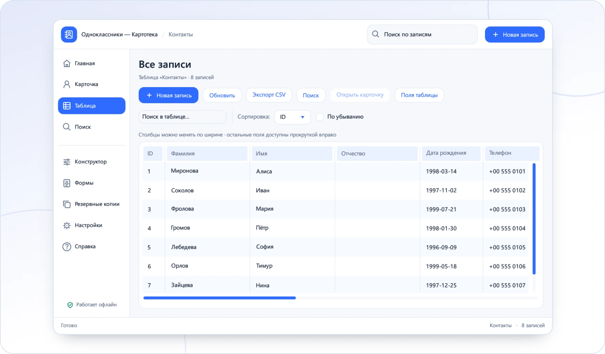

<!-- ppk-readme:head:start -->
<a href="https://popovantondev.github.io/Kartoteka/index-ru.html"><picture><source media="(prefers-color-scheme: dark)" srcset="https://raw.githubusercontent.com/popovantondev/Kartoteka/main/docs/readme/header-ru-dark.64884694.svg"></picture></a>
<!-- ppk-readme:head:end -->

# Картотека

**Русский** · [Deutsch](README.md) · [English](README.en.md)

<!-- ppk-readme:body:start -->

<a href="https://github.com/popovantondev/Kartoteka/releases/tag/v0.5.0"><picture><source media="(prefers-color-scheme: dark)" srcset="https://raw.githubusercontent.com/popovantondev/Kartoteka/main/docs/readme/btn-download-ru-dark.8e2bf20d.svg"></picture></a>
<a href="https://popovantondev.github.io/Kartoteka/index-ru.html"><picture><source media="(prefers-color-scheme: dark)" srcset="https://raw.githubusercontent.com/popovantondev/Kartoteka/main/docs/readme/btn-website-ru-dark.cf40f8dc.svg"></picture></a>
<a href="https://popovantondev.github.io/Kartoteka/Guide-ru.html"><picture><source media="(prefers-color-scheme: dark)" srcset="https://raw.githubusercontent.com/popovantondev/Kartoteka/main/docs/readme/btn-guide-ru-dark.6c8e5a1d.svg"></picture></a>
<a href="https://popovantondev.github.io/Kartoteka/index-ru.html#demo"><picture><source media="(prefers-color-scheme: dark)" srcset="https://raw.githubusercontent.com/popovantondev/Kartoteka/main/docs/readme/btn-demo-ru-dark.65d8950a.svg"></picture></a>
<a href="https://github.com/popovantondev/Kartoteka/issues/new"><picture><source media="(prefers-color-scheme: dark)" srcset="https://raw.githubusercontent.com/popovantondev/Kartoteka/main/docs/readme/btn-bug-ru-dark.4357b3de.svg"></picture></a>

<a href="https://raw.githubusercontent.com/popovantondev/Kartoteka/main/docs/assets/app-ru.png"><picture><source media="(prefers-color-scheme: dark)" srcset="https://raw.githubusercontent.com/popovantondev/Kartoteka/main/docs/readme/preview-ru-dark.7bf4497e.webp"></picture></a> 
<a href="https://raw.githubusercontent.com/popovantondev/Kartoteka/main/docs/assets/app-ru.png">Снимок целиком</a>

<picture><source media="(prefers-color-scheme: dark)" srcset="https://raw.githubusercontent.com/popovantondev/Kartoteka/main/docs/readme/divider-dark.2ce65351.svg"></picture>
<!-- ppk-readme:body:end -->

Храните карточки людей, коллекции и другие списки на своём компьютере. Таблицы, собственные поля, фотографии, документы, поиск и резервные копии — в одном приложении.

**Личная картотека для Windows · 0.5.0 · Windows 11 x64**

Настоящий интерфейс 0.5.0. Примерные записи, без личных данных.

## Что умеет программа

- Карточка записи и общая таблица с изменяемой шириной столбцов.
- Собственные таблицы и 11 типов полей: короткий и длинный текст, целые и десятичные числа, дата, время, дата и время, флажок, URL, фото и документ.
- Фотографии с предпросмотром, управляемые локальные копии документов и ссылки на сайты.
- Поиск по всей выбранной таблице, фильтр загруженных строк и экспорт CSV.
- Резервное копирование базы вместе с вложениями и восстановление с защитным снимком.
- Светлая тема, масштаб 80–150%, сворачиваемое меню и русский, немецкий, английский интерфейс.

## Установка и запуск

Запустите Kartoteka-0.5.0-Setup.exe и оставьте предложенную папку текущего пользователя. Права администратора и Rust не требуются. Перед обновлением сохраните изменения и закройте старое окно. Для запуска без установки распакуйте весь переносной ZIP: EXE и три DLL должны находиться рядом.

## Выбор языка

Откройте Настройки → Общие или Внешний вид → Язык интерфейса и выберите Русский, Deutsch или English. Выбор сохраняется после перезапуска. Хранимые имена и значения не переписываются; стандартные подписи отображаются на выбранном языке. Окна выбора файлов используют язык Windows.

## Первая запись

Нажмите «Новая запись», заполните обязательные фамилию и имя, добавьте фото или документ и нажмите «Сохранить». Между карточками можно переходить нижними кнопками. В таблице двойной щелчок открывает карточку. При уходе с изменённой карточки программа предлагает сохранить её.

## Таблицы и поля

В Конструкторе создайте таблицу и добавьте поля, выбрав имя, тип, обязательность и значение по умолчанию. Порядок меняется стрелками, ширина столбцов — перетягиванием заголовков. В разделе Формы настраивается видимость и показывается предпросмотр. Удаление поля требует подтверждения и защитной копии.

## Фото и документы

Выбранный файл копируется в управляемую папку вложений; сохраните запись, чтобы закрепить его. Фото: JPG/JPEG, PNG, BMP, WEBP, до 25 МБ и 40 мегапикселей. Прочие документы: до 250 МБ. Открытие документа передаёт файл системному приложению. Ссылки HTTP/HTTPS открываются в браузере.

## Поиск по программам

Поиск

## Сохранность и перенос

Папка данных: %LOCALAPPDATA%\Popovantondev\Kartoteka. Здесь находятся program_data.db, assets, backups и preferences.json. Данные не шифруются. Для переноса создайте резервную копию и скопируйте всю папку данных на другой компьютер при закрытой программе. Кнопка восстановления работает с копиями в списке приложения; перед заменой создаётся защитный снимок. Удаление программы сохраняет данные.

## Горячие клавиши

Ctrl+S — сохранить; Ctrl+N — новая запись; Ctrl+F — поиск. Разделитель левого меню поддерживает перетягивание и двойной щелчок; при узком окне меню сворачивается автоматически.

## Требования и ограничения

Проверено на Windows 11 x64. EXE не подписан. Таблица показывает до 2000 строк, поиск — до 500 результатов. Свободное перетягивание полей формы и импорт Microsoft Access не реализованы. Системный DPI 125/150% и два монитора отдельно не проверены; качество сглаживания зависит от рендера egui. Программа не отправляет телеметрию; основные функции работают офлайн.

## Сборка из исходников

Нужны Rust stable-x86_64-pc-windows-gnullvm, rustfmt и LLVM-MinGW. scripts/build-noadmin.ps1 ищет LLVM-MinGW в %LOCALAPPDATA%\Popovantondev\KartotekaTools, выполняет fmt/check/test/release и собирает dist с EXE и DLL. Для установщика: scripts/build-setup.ps1 -NsisPath <путь к makensis.exe>. NSIS 3.11. Зависимости закреплены Cargo.lock. Исходники опубликованы без изменения лицензий зависимостей; права на код проекта — в RIGHTS.ru.md.

## Изменения 0.5.0

Добавлены RU/DE/EN с сохранением выбора, переведены экраны, справка, диалоги и сообщения проверки. Локализован календарь; установщик предлагает три языка. Схема базы и формат вложений совместимы с 0.4.2.

## Проверки

Проверки сборки, языка, сохранения данных и установщика описаны в RELEASE-CHECKS.md. Контрольные суммы файлов выпуска — SHA256SUMS.txt. Проверка документации не заменяет запуск программы на вашем оборудовании.

## Права и использование

Исходный код открыт для просмотра; это не открытая лицензия. Неизменённый релиз можно скачать и запускать для личного использования. Подробности — RIGHTS.ru.md; права на сторонние компоненты — в third-party/README.md.

[Сообщить об ошибке](https://github.com/popovantondev/Kartoteka/issues/new) · [Исходники](https://github.com/popovantondev/Kartoteka)
