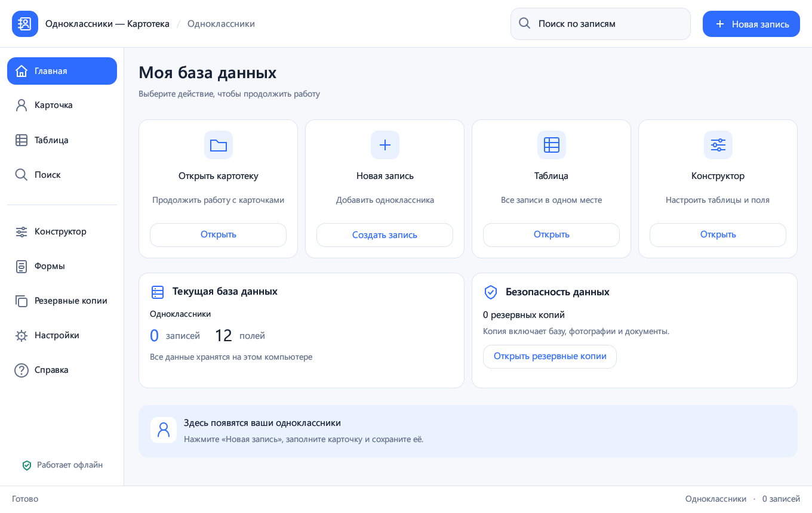

# Одноклассники — Картотека

[RU](../README.ru.md) · [DE](../README.de.md) · [EN](../README.md)

**Личная картотека для Windows · 0.5.0 · Windows 11 x64**

Храните карточки одноклассников и другие списки на своём компьютере. Таблицы, собственные поля, фотографии, документы, поиск и резервные копии — в одном приложении.

[Скачать для Windows](https://github.com/popovantondev/Kartoteka/releases/download/v0.5.0/Kartoteka-0.5.0-Setup.exe) · [Переносной ZIP](https://github.com/popovantondev/Kartoteka/releases/download/v0.5.0/Kartoteka-0.5.0-Windows-x64.zip) · [Руководство](https://popovantondev.github.io/Kartoteka/Guide-ru.html) · [Все программы](https://popovantondev.github.io/popovantondev/index-ru.html)

Настоящий интерфейс 0.5.0. Демонстрационная база без личных данных.

## Что умеет программа

- Карточка записи и общая таблица с изменяемой шириной столбцов.
- Собственные таблицы и 11 типов полей: текст, числа, дата, время, дата и время, флажок, URL, фото и документ.
- Фотографии с предпросмотром, управляемые локальные копии документов и ссылки на сайты.
- Поиск по всей выбранной таблице, фильтр загруженных строк и экспорт CSV.
- Резервное копирование базы вместе с вложениями и восстановление с защитным снимком.
- Светлая тема, масштаб 80–150%, сворачиваемое меню и русский, немецкий, английский интерфейс.

## Установка и запуск

Запустите Kartoteka-0.5.0-Setup.exe и оставьте предложенную папку текущего пользователя. Права администратора и Rust не требуются. Перед обновлением сохраните изменения и закройте старое окно. Для запуска без установки распакуйте весь переносной ZIP: EXE и три DLL должны находиться рядом.

## Выбор языка

Откройте Настройки → Общие или Внешний вид → Язык интерфейса и выберите Русский, Deutsch или English. Выбор сохраняется после перезапуска. Хранимые имена и значения не переписываются; стандартные подписи отображаются на выбранном языке. Окна выбора файлов используют язык Windows.

## Первая запись

Нажмите «Новая запись», заполните обязательные фамилию и имя, добавьте фото или документ и нажмите «Сохранить». Между карточками можно переходить нижними кнопками. В таблице двойной щелчок открывает карточку. При уходе с изменённой карточки программа предлагает сохранить её.

## Таблицы и поля

В Конструкторе создайте таблицу и добавьте поля, выбрав имя, тип, обязательность и значение по умолчанию. Порядок меняется стрелками, ширина столбцов — перетягиванием заголовков. В разделе Формы настраивается видимость и показывается предпросмотр. Удаление поля требует подтверждения и защитной копии.

## Фото и документы

Выбранный файл копируется в управляемую папку вложений; сохраните запись, чтобы закрепить его. Фото: JPG/JPEG, PNG, BMP, WEBP, до 25 МБ и 40 мегапикселей. Прочие документы: до 250 МБ. Открытие документа передаёт файл системному приложению. Ссылки HTTP/HTTPS открываются в браузере.

## Поиск и CSV

Поиск проверяет все поля выбранной таблицы. Фильтр таблицы работает по уже загруженным строкам. CSV экспортирует выбранную таблицу; текст экранируется для защиты от формул электронных таблиц. Значения дат сохраняются в формате YYYY-MM-DD, время — HH:MM.

## Сохранность и перенос

Папка данных: %LOCALAPPDATA%\Popovantondev\Kartoteka. Здесь находятся program_data.db, assets, backups и preferences.json. Данные не шифруются. Для переноса создайте резервную копию и скопируйте всю папку данных на другой компьютер при закрытой программе. Кнопка восстановления работает с копиями в списке приложения; перед заменой создаётся защитный снимок. Удаление программы сохраняет данные.

## Горячие клавиши

Ctrl+S — сохранить; Ctrl+N — новая запись; Ctrl+F — поиск. Разделитель левого меню поддерживает перетягивание и двойной щелчок; при узком окне меню сворачивается автоматически.

## Требования и ограничения

Проверено на Windows 11 x 64. EXE не подписан. Таблица показывает до 2000 строк, поиск — до 500 результатов. Свободное перетягивание полей формы и импорт Microsoft Access не реализованы. Системный DPI 125/150% и два монитора отдельно не проверены; качество сглаживания зависит от рендера egui. Программа не отправляет телеметрию; основные функции работают офлайн.

## Сборка из исходников

Нужны Rust stable-x 86_64-pc-windows-gnullvm, rustfmt и LLVM-MinGW. scripts/build-noadmin.ps 1 ищет LLVM-MinGW в %LOCALAPPDATA%\Popovantondev\KartotekaTools, выполняет fmt/check/test/release и собирает dist с EXE и DLL. Для установщика: scripts/build-setup.ps 1 -NsisPath <путь к makensis.exe>. NSIS 3.11. Зависимости закреплены Cargo.lock. Исходники опубликованы без изменения лицензий зависимостей; отдельная лицензия на код проекта пока не назначена.

## Изменения 0.5.0

Добавлены RU/DE/EN с сохранением выбора, переведены экраны, справка, диалоги и сообщения проверки. Локализован календарь; установщик предлагает три языка. Схема базы и формат вложений совместимы с 0.4.2.

## Проверки

Проверки сборки, языка, сохранения данных и установщика описаны в RELEASE-CHECKS.md. Контрольные суммы файлов выпуска — SHA 256 SUMS.txt. Проверка документации не заменяет запуск программы на вашем оборудовании.

[Сообщить об ошибке](https://github.com/popovantondev/Kartoteka/issues/new) · [Исходники](https://github.com/popovantondev/Kartoteka)
