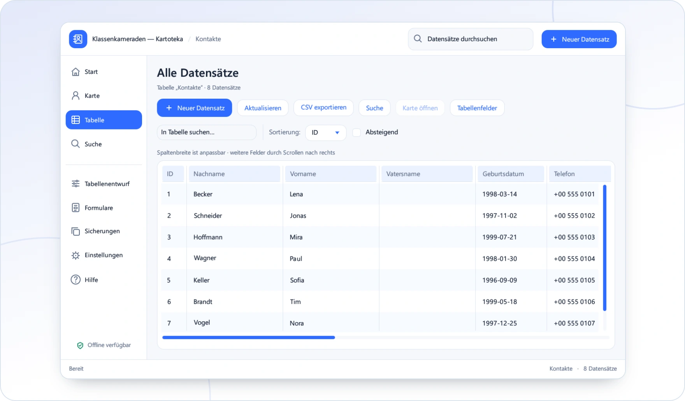

<!-- ppk-readme:body:start -->

<a href="https://github.com/popovantondev/Kartoteka/releases/tag/v0.5.0"><picture><source media="(prefers-color-scheme: dark)" srcset="https://raw.githubusercontent.com/popovantondev/Kartoteka/main/docs/readme/btn-download-de-dark.5d0b3f75.svg"></picture></a>
<a href="https://popovantondev.github.io/Kartoteka/index.html"><picture><source media="(prefers-color-scheme: dark)" srcset="https://raw.githubusercontent.com/popovantondev/Kartoteka/main/docs/readme/btn-website-de-dark.a94992bb.svg"></picture></a>
<a href="https://popovantondev.github.io/Kartoteka/Guide-de.html"><picture><source media="(prefers-color-scheme: dark)" srcset="https://raw.githubusercontent.com/popovantondev/Kartoteka/main/docs/readme/btn-guide-de-dark.28dc7d6c.svg"></picture></a>
<a href="https://popovantondev.github.io/Kartoteka/index.html#demo"><picture><source media="(prefers-color-scheme: dark)" srcset="https://raw.githubusercontent.com/popovantondev/Kartoteka/main/docs/readme/btn-demo-de-dark.63a9170b.svg"></picture></a>
<a href="https://github.com/popovantondev/Kartoteka/issues/new"><picture><source media="(prefers-color-scheme: dark)" srcset="https://raw.githubusercontent.com/popovantondev/Kartoteka/main/docs/readme/btn-bug-de-dark.accec5cd.svg"></picture></a>

<a href="https://raw.githubusercontent.com/popovantondev/Kartoteka/main/docs/assets/app-de.png"><picture><source media="(prefers-color-scheme: dark)" srcset="https://raw.githubusercontent.com/popovantondev/Kartoteka/main/docs/readme/preview-de-dark.d71ad366.webp"></picture></a> 
<a href="https://raw.githubusercontent.com/popovantondev/Kartoteka/main/docs/assets/app-de.png">Ganzer Screenshot</a>

<picture><source media="(prefers-color-scheme: dark)" srcset="https://raw.githubusercontent.com/popovantondev/Kartoteka/main/docs/readme/divider-dark.2ce65351.svg"></picture>
<!-- ppk-readme:body:end -->
