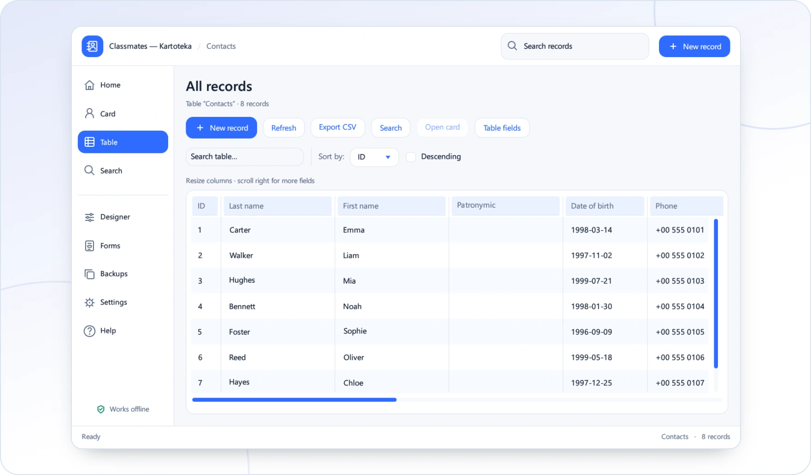

<!-- ppk-readme:body:start -->

<a href="https://github.com/popovantondev/Kartoteka/releases/tag/v0.5.0"><picture><source media="(prefers-color-scheme: dark)" srcset="https://raw.githubusercontent.com/popovantondev/Kartoteka/main/docs/readme/btn-download-en-dark.e539ee75.svg"></picture></a>
<a href="https://popovantondev.github.io/Kartoteka/index-en.html"><picture><source media="(prefers-color-scheme: dark)" srcset="https://raw.githubusercontent.com/popovantondev/Kartoteka/main/docs/readme/btn-website-en-dark.0a4a827a.svg"></picture></a>
<a href="https://popovantondev.github.io/Kartoteka/Guide-en.html"><picture><source media="(prefers-color-scheme: dark)" srcset="https://raw.githubusercontent.com/popovantondev/Kartoteka/main/docs/readme/btn-guide-en-dark.aa8dc4fd.svg"></picture></a>
<a href="https://popovantondev.github.io/Kartoteka/index-en.html#demo"><picture><source media="(prefers-color-scheme: dark)" srcset="https://raw.githubusercontent.com/popovantondev/Kartoteka/main/docs/readme/btn-demo-en-dark.8b547d19.svg"></picture></a>
<a href="https://github.com/popovantondev/Kartoteka/issues/new"><picture><source media="(prefers-color-scheme: dark)" srcset="https://raw.githubusercontent.com/popovantondev/Kartoteka/main/docs/readme/btn-bug-en-dark.fa7f7e14.svg"></picture></a>

<a href="https://raw.githubusercontent.com/popovantondev/Kartoteka/main/docs/assets/app-en.png"><picture><source media="(prefers-color-scheme: dark)" srcset="https://raw.githubusercontent.com/popovantondev/Kartoteka/main/docs/readme/preview-en-dark.3578c37e.webp"></picture></a> 
<a href="https://raw.githubusercontent.com/popovantondev/Kartoteka/main/docs/assets/app-en.png">Full screenshot</a>

<picture><source media="(prefers-color-scheme: dark)" srcset="https://raw.githubusercontent.com/popovantondev/Kartoteka/main/docs/readme/divider-dark.2ce65351.svg"></picture>
<!-- ppk-readme:body:end -->
