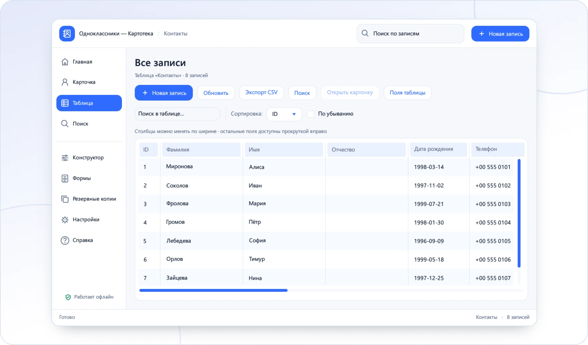

<!-- ppk-readme:body:start -->

<a href="https://github.com/popovantondev/Kartoteka/releases/tag/v0.5.0"><picture><source media="(prefers-color-scheme: dark)" srcset="https://raw.githubusercontent.com/popovantondev/Kartoteka/main/docs/readme/btn-download-ru-dark.8e2bf20d.svg"></picture></a>
<a href="https://popovantondev.github.io/Kartoteka/index-ru.html"><picture><source media="(prefers-color-scheme: dark)" srcset="https://raw.githubusercontent.com/popovantondev/Kartoteka/main/docs/readme/btn-website-ru-dark.cf40f8dc.svg"></picture></a>
<a href="https://popovantondev.github.io/Kartoteka/Guide-ru.html"><picture><source media="(prefers-color-scheme: dark)" srcset="https://raw.githubusercontent.com/popovantondev/Kartoteka/main/docs/readme/btn-guide-ru-dark.6c8e5a1d.svg"></picture></a>
<a href="https://popovantondev.github.io/Kartoteka/index-ru.html#demo"><picture><source media="(prefers-color-scheme: dark)" srcset="https://raw.githubusercontent.com/popovantondev/Kartoteka/main/docs/readme/btn-demo-ru-dark.65d8950a.svg"></picture></a>
<a href="https://github.com/popovantondev/Kartoteka/issues/new"><picture><source media="(prefers-color-scheme: dark)" srcset="https://raw.githubusercontent.com/popovantondev/Kartoteka/main/docs/readme/btn-bug-ru-dark.4357b3de.svg"></picture></a>

<a href="https://raw.githubusercontent.com/popovantondev/Kartoteka/main/docs/assets/app-ru.png"><picture><source media="(prefers-color-scheme: dark)" srcset="https://raw.githubusercontent.com/popovantondev/Kartoteka/main/docs/readme/preview-ru-dark.7bf4497e.webp"></picture></a> 
<a href="https://raw.githubusercontent.com/popovantondev/Kartoteka/main/docs/assets/app-ru.png">Снимок целиком</a>

<picture><source media="(prefers-color-scheme: dark)" srcset="https://raw.githubusercontent.com/popovantondev/Kartoteka/main/docs/readme/divider-dark.2ce65351.svg"></picture>
<!-- ppk-readme:body:end -->
